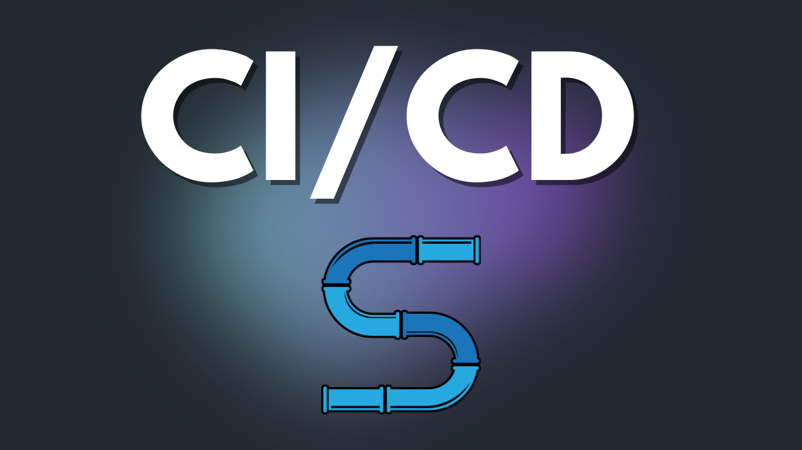
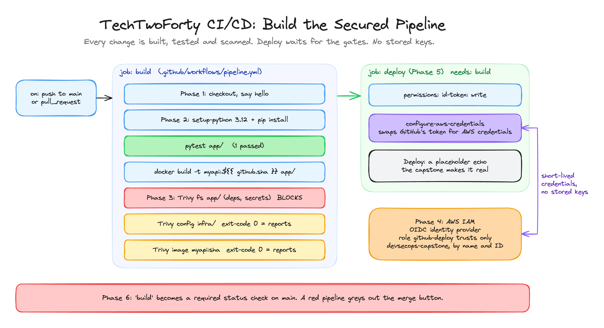

<p align="center">
  
</p>

<h1 align="center">TechTwoForty: CI/CD</h1>
<p align="center"><b>Build the Secured Pipeline</b> · the finished project</p>
<p align="center">
  <a href="https://github.com/wjpearce-github/TechTwoForty-Git">← Previous: Git</a> ·
  <a href="https://github.com/wjpearce-github/TechTwoForty-Start-Here">Course map</a> ·
  <a href="https://github.com/wjpearce-github/TechTwoForty-Security">Next: Security →</a>
</p>

> [!TIP]
> **This repo is the finished template for the CI/CD project. Treat it as your cheat sheet.**
> It is your `devsecops-capstone` repo at the end of the CI/CD project: everything from the Git project, plus `.github/workflows/pipeline.yml` with all four parts in it (skeleton, build and test, three Trivy scans, OIDC deploy job). The commit history shows the pipeline growing one push at a time on a `pipeline` branch, then merged.

| | |
|---|---|
| **Section** | 7 of 10 · Automation |
| **Time** | About 60 minutes, 6 phases |
| **Runs on** | GitHub Actions, your capstone repo, and an AWS account for the deploy role |
| **Deliverable** | A pipeline that gates every change on tests and scans, deploys through a short-lived role with no stored keys, and is a required check on `main` |

> [!WARNING]
> **GitHub Actions is switched off on this template repo.** There is no AWS account behind it, so the deploy job could never sign in. In **your** repo the pipeline runs on every push and pull request.

## The big picture



<sub>Drawn in Excalidraw. To edit it, open <code>assets/diagram.excalidraw</code> at <a href="https://excalidraw.com">excalidraw.com</a>.</sub>

## What is in this repo

```text
devsecops-capstone/                    (this template repo)
├── .github/workflows/pipeline.yml     NEW: the finished pipeline
├── .gitignore                         from the Git project
├── app/                               from the Git project (the Docker app)
├── infra/                             from the Git project (the Terraform network)
├── docs/example-README.md             your README.md, unchanged since the Git project
└── reference/
    └── github-deploy-trust.json       the trust policy you write at ~/github-deploy-trust.json
```

`reference/` holds a file that lives **outside** your repo in the walkthrough (in your home folder). It is here so you can check it.

## Cheat sheet, phase by phase

Every change goes branch, push, PR, merge. Main is protected, so you use the pipeline's own process to build the pipeline.

```bash
cd ~/devsecops-capstone && git switch -c pipeline && mkdir -p .github/workflows
code .github/workflows/pipeline.yml
```

| Phase | What you add to `pipeline.yml` | Commit message |
|---|---|---|
| 1 · Skeleton | `on: push (main), pull_request`, checkout, `echo "Pipeline is running"` | `Add pipeline skeleton` |
| 2 · Build and test | setup-python 3.12, `pip install -r app/requirements.txt`, `pytest app/`, `docker build -t myapi:${{ github.sha }} app/` | `Build and test in the pipeline` |
| 3 · Security gates | Trivy `fs app/` (exit-code **1**, blocks), Trivy `config infra/` (exit-code 0), Trivy `image` (exit-code 0) | `Add security scans as pipeline gates` |
| 5 · Deploy job | `deploy:` with `needs: build`, `id-token: write`, configure-aws-credentials (OIDC), placeholder echo | `Add OIDC deploy job` |

After each push, watch the **Actions** tab. Reading the log is half the skill.

### The fail-or-report decision (Phase 3)

| Scan | `exit-code` | Why |
|---|---|---|
| Dependencies + secrets in `app/` | `1` | A HIGH finding fails the build |
| IaC in `infra/` | `0` | Reports only, for now. The Security section fixes the serious ones and turns it into a gate |
| Container image | `0` | Reports only, for now |

### Phase 4 · Trust without keys (OIDC)

1. IAM, Identity providers: `token.actions.githubusercontent.com`, audience `sts.amazonaws.com` (skip if it exists from CI/CD Unit 5).
2. Get your owner and repo IDs:

```bash
curl -s https://api.github.com/repos/yourname/devsecops-capstone | python3 -c "import sys, json; r = json.load(sys.stdin); print('Owner ID:', r['owner']['id']); print('Repo ID: ', r['id'])"
```

3. Fill in [`reference/github-deploy-trust.json`](reference/github-deploy-trust.json) (`ACCOUNT_ID`, `yourname` twice, `OWNER_ID`, `REPO_ID`), save it as `~/github-deploy-trust.json`, then:

```bash
aws iam create-role --role-name github-deploy --assume-role-policy-document file://$HOME/github-deploy-trust.json --query Role.Arn --output text
```

The role has **no permissions** yet, on purpose. The capstone builds the real, least-privilege deploy role.

### Phase 5 · The deploy job
Replace `ACCOUNT_ID` in the `role-to-assume` line before you push. `needs: build` is the gate: if anything upstream is red, deploy never runs.

### Phase 6 · Close the gate
Merge the pipeline PR. Then Settings, Branches, the `main` rule, **Require status checks to pass**: search for and select `build`. From now on the merge button stays grey until the pipeline is green.

## Final handover check

- [ ] Every push runs build, test, three scans, and a gated deploy
- [ ] The dependency scan fails the build on HIGH findings, and the other two only report
- [ ] The deploy role is assumed through OIDC, with no stored keys
- [ ] `main` will not merge a PR whose pipeline is red

## Common mistakes

| Mistake | What happens | The fix |
|---|---|---|
| Forgetting to replace `ACCOUNT_ID` | The credentials step fails | Put your account number in both places |
| Missing `permissions: id-token: write` | OIDC cannot get a token | It sits on the deploy job |
| Trust policy subject typo | `Not authorized to perform sts:AssumeRoleWithWebIdentity` | Print the IDs again and compare, character by character |
| Committing straight to main | Rejected: main is protected | Branch, push, PR, merge |

> [!CAUTION]
> This project uses `aquasecurity/trivy-action@v0.36.0`, a **version tag**. In March 2026 attackers moved almost every trivy-action tag to code that stole secrets. The Security section pins every action to a full commit SHA, and the capstone explains why. Do the Security section before you trust a tag again.

## What you can now do

- **GitHub Actions:** workflows, jobs, steps, triggers and marketplace actions
- **Security gates:** scanners as pipeline steps, with deliberate fail-or-report decisions
- **OIDC:** short-lived cloud credentials instead of stored secrets
- **Enforcement:** required checks that make the pipeline mandatory

---

<p align="center">
  <b>TechTwoForty</b> · CI/CD · 7 of 10<br>
  <a href="https://github.com/wjpearce-github/TechTwoForty-Git">← Previous: Git</a> ·
  <a href="https://github.com/wjpearce-github/TechTwoForty-Start-Here">Course map</a> ·
  <a href="https://github.com/wjpearce-github/TechTwoForty-Security">Next: Security →</a>
</p>
